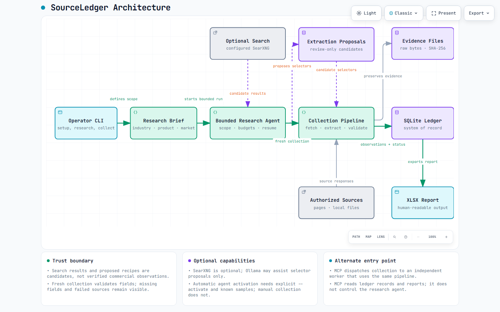

# SourceLedger

[English](README.md) | [한국어](README.ko.md)


SourceLedger is a local, evidence-first tool for researching sources, collecting product prices, preserving source material, and creating XLSX reports. It never estimates prices or substitutes missing values with zero.

Each collection records the source URL, UTC timestamp, raw fields, CSS/JSON/table location, evidence-file path, and SHA-256 hash. A row can be `verified` only when the product, price, and currency are supported by source evidence. A verified row is excluded from comparisons when its conditions are insufficient (`comparable=false`). For example, SourceLedger does not calculate a normalized unit price without source evidence of whether a price is for a pack or an individual item.

Raw or static HTML prices remain preserved, but are not comparable until rendered display evidence is available. Structured files and document records use their record evidence instead. Source Evidence links retained content and, when captured, screenshots and collection receipts.

## How it works

See [collection limits and recovery](docs/LIMITATION_MANAGEMENT.md) for reviewed dynamic recipes, authorized browser profiles, and the SQLite issue ledger. [Implementation review](docs/LIMITATION_IMPLEMENTATION_REVIEW.md) records validation and remaining boundaries.

Read the [collection reliability changes](docs/CROSS_SITE_RELIABILITY_2026-10-14.md) for coverage status, retained-evidence reanalysis, and known limits.

[](docs/ARCHITECTURE.md)

The bounded agent turns source candidates into extraction proposals, collects fresh evidence, and records validated observations in SQLite before producing an XLSX report. Missing values remain missing. Optional search, model assistance, and activation have explicit limits.

Read the [architecture and Archify guide](docs/ARCHITECTURE.md) ([한국어](docs/ARCHITECTURE.ko.md)) for the code-backed flow, skill setup, and rebuild commands. Download [the interactive HTML](docs/architecture/sourceledger.html) and open it locally; GitHub shows its source rather than running the viewer. [Archify](https://github.com/tt-a1i/archify) is a documentation tool used to create this map.

## Quick start

Recommended host models are **Sol for Codex** and **Opus for Claude**; existing model choices remain unchanged. Before collecting, review the execution plan showing selected sites, requested/unknown host model, page/time limits, and checkpoints. MCP clients can read `get_research_execution_plan`. New UI/MCP jobs default to bounded concurrency 2 in one workspace (up to 2 per host, browser capture 1). Choose 1 for sequential collection. Use `get_research_progress` for compact MCP polling. Exa discovery through an existing host connection is optional; see [implementation details](docs/CRAWLER_IMPROVEMENTS.md). See the [measured performance](docs/COLLECTION_PERFORMANCE.md) and [Exa MCP / Scrapy architecture review](docs/UPSTREAM_ARCHITECTURE_REVIEW.md).

For a large fixed inventory, approve the full plan once and use `start_research_batch_run`. The server processes bounded batches and persists checkpoints without a separate AI approval cycle for each batch. See [approved inventory collection](docs/SERVER_BATCH_COLLECTION.md).

New research plans default to incremental collection with a full recheck due every 7 days; you can select full mode or change the interval before execution. The first run, a due interval, changed rules, or an invalid baseline triggers a full recheck. The due date is checked when another run starts; it does not start a background schedule. Each run compares only approved and visited URLs. Detailed per-URL changes are retained in SQLite and XLSX, while MCP progress returns at most 50 change entries. An unavailable page is a gap, never an inferred removal or a copied current observation. See [collection reliability](docs/COLLECTION_RELIABILITY.md).

Incremental mode is not a promise to visit only changed URLs. Browser-dependent pages still require fresh rendering; full mode also reports changes against the last valid baseline. Use full mode for browser-heavy collections unless a measured comparison demonstrates a benefit.

SourceLedger supports Python 3.11 or later; Python 3.12 is recommended. Clone this repository, or download and extract its GitHub ZIP. The default setup installs the local core only. See [installation](docs/INSTALLATION.md) for macOS/Linux, browser, MCP, developer-test, Linux dependency, headless browser mode, and moving-computer instructions.

```bat
setup.cmd
source-ledger.cmd
```

The second command opens the local browser UI. Write a short or detailed multiline research request, review a bounded AI preview of possible sources, then edit and select targets. Confirm the industry, product, market, and selected pages before starting bounded collection. Exact product identifiers are an advanced option for precise matching, not a prerequisite for this plan flow. The UI binds only to `127.0.0.1`, with port `8765` and workspace `.sourceledger` as defaults. Read the [browser UI guide](docs/WEB_UI.md) for the complete workflow.

The launchers use the repository `.venv` by location, so Windows does not need PowerShell activation or an execution-policy change. The block above is for Command Prompt; in PowerShell use `.\setup.cmd` and `.\source-ledger.cmd`. On macOS/Linux, run `bash setup.sh` followed by `bash source-ledger.sh`. A repository launcher with no arguments opens the UI.

The core installation is enough for the UI and local-file workflows. Install optional Playwright collection and MCP support when needed. For web UI recommendations, separately install and sign in to [Codex CLI](https://developers.openai.com/codex/cli/) or [Claude Code](https://code.claude.com/docs/en/setup) using the providers’ official instructions:

```powershell
.\setup.cmd --browser --mcp
```

`--browser` adds Playwright collection. `--mcp` adds Codex and Claude MCP connections. Neither is required just to open the UI. For conversation-based use after installing MCP, follow the [local assistant setup](docs/ASSISTANT_CONNECTIONS.md).

### Browser UI

The browser UI is the primary local starting point in 0.5. It provides five areas:

Choose **English**, **한국어**, or **日本語** from the top-bar **Language** selector (shown as **언어** in Korean and **言語** in Japanese). English is the default; your choice is saved in browser `localStorage` for this local UI origin. Switching language updates labels, status text, and date formatting without reloading or clearing form inputs and checkbox selections. It does not translate stored source content or evidence, prices, model IDs, MCP configuration, research-workspace locale, or report data, and it makes no AI translation or external calls.

- **Research plan** — full request, source preview, user edits and selection, confirmation, and bounded collection.
- **Overview** — first-run setup, research readiness, and independent-worker controls.
- **Sources** — exact product identity, direct URL registration, company/keyword recommendation requests, candidate selection, bounded discovery, and extraction proposals.
- **Runs** — queued-job status, evidence status, paginated observations, and registered XLSX reports.
- **Connections** — copyable AI-app settings and optional Codex CLI or Claude Code CLI provider settings. It does not rewrite client settings.

The web UI runs the research-plan preview on this screen by default. Choose a Codex CLI or Claude Code CLI provider and model in **Connections**, then click **Preview research plan**. Opening the page does not call an AI provider.

- **Web UI (default):** Click the preview button to run the configured AI provider and model from this screen.
- **Connected AI app (optional):** Use the app's search/browser tools to inspect references, then submit the preview through MCP. Choose the model in that app.

Web execution requires the CLI installed and signed in on the computer running SourceLedger; native CLI account usage applies. Choose the provider default, a suggested model, or a custom model ID. The timeout is 180 seconds by default and adjustable from 30 to 600 seconds. Web settings do not change the model in an open AI app. See [Browser UI](docs/WEB_UI.md) for setup and execution details.

Preview references are unverified and never become price observations. Add, remove, or select candidates and confirm the complete plan revision before starting collection. Collection visits selected pages and bounded same-host links, records coverage gaps, and produces SQLite evidence and XLSX. Generic JSON-LD Product/Offer extraction can preserve prices and attributes on other hosts, but embedded prices need review and are not comparable without display proof. Arbitrary page layouts and natural-language commercial-condition checks are not automated; missing prices, currencies, identifiers, and conditions remain missing.

Research plans ask for a missing research region before suggesting sources. Editable product conditions are separate from optional literal filters; collection reports matched, unknown, excluded, and unchecked products without inventing missing evidence. The start button shows missing requirements, and source candidates are clearly separated from product checks.

The advanced guided-research path uses only registered sources you select (up to 50) and has a 120-second budget. Plan collection uses a separate page budget (10 by default). Existing collection model calls remain opt-in and default to zero; the CLI agent example below retains its separate default of three sources.

Start and stop the independent worker from the UI when queued work is needed. Closing the browser tab or the UI web server does not cancel jobs already owned by that worker. The UI and Codex/Claude MCP connector can share the same workspace and job history. A job marked `succeeded` completed its program execution; inspect its separate evidence status before treating a price as verified.

During collection, confirmed CAPTCHA/access challenges and required authentication appear as nonblocking browser alerts and in the Runs attention list. Other URLs keep collecting. `get_research_progress` also returns bounded attention items. Opening the affected URL does not transfer your browser session to the worker, resolve the issue automatically, or verify missing values. Use [browser recovery](docs/BROWSER_RECOVERY.md) or [MCP follow-up](docs/MCP_FOLLOWUP.md) for evidence and triage.

Advanced launch options are available from the installed command or repository launcher:

```powershell
.\source-ledger.cmd ui --workspace-root .sourceledger --port 8765 --no-browser
```

The UI is a local interface. This milestone does not provide remote hosting, a third-party MCP client, or a ChatGPT web connection.

### CLI quick check

The demo reads synthetic HTML and CSV fixtures only. It does not contain market prices.

```powershell
.\source-ledger.cmd run --config examples/demo.json
.\source-ledger.cmd status --config examples/demo.json --run-id <RUN_ID>
.\source-ledger.cmd observations --config examples/demo.json --run-id <RUN_ID>
.\source-ledger.cmd export --config examples/demo.json --run-id <RUN_ID>
.\source-ledger.cmd doctor
```

`su-crawler` remains a compatible command alias. Use `source-ledger` for new scripts and documentation. In the command examples below, use the launcher prefix for a portable checkout, or invoke the installed `source-ledger` command only when it is available in your shell.

Run a bounded batch with `run --max-tasks N`, then continue it with `run --resume <RUN_ID>`. Outputs are stored below the configured `output_dir`: a SQLite run history, source evidence, and an XLSX report.

## Configuration

Start a research workspace on first use. English is the default; `--lang ko` enables Korean setup prompts and next actions.

```powershell
.\source-ledger.cmd init
.\source-ledger.cmd research-status
```

Setup asks for industry, product, and market. It does not ask for an analysis purpose. Then register authorized source URLs, optionally discover links, supply exact identifiers, and create a collection draft. See [the getting-started guide](docs/GETTING_STARTED.md) for the complete workflow and [the roadmap](docs/ROADMAP.md) for remaining automation work.

The research workspace supports one product lead; collection configurations support multiple exact products. `draft` creates a manual starting point; `propose` can inspect source HTML and suggest extraction rules. Both remain separate from verified observations.

### Bounded research execution

Version 0.3 added optional SearXNG keyword search, source-backed selector proposals, and a checkpointed controller. After setup, register authorized URLs and exact identifiers, then run:

```powershell
.\source-ledger.cmd product-set --identifier model=YOUR_EXACT_MODEL
.\source-ledger.cmd source-add --url "https://your-vendor.example/product"
.\source-ledger.cmd agent --run-dir .sourceledger/runs/run-001 --max-sources 3 --max-seconds 120
```

The agent proposes rules for selected sources, then performs a fresh combined collection and verification into SQLite and XLSX. Incomplete sources remain visible. `--resume` preserves saved scope and budgets; `--max-steps` pauses at a source boundary. External operations use bounded timeouts; the overall time budget is cooperative, not a hard process kill.

Keyword search requires an explicitly configured SearXNG server. Optional Ollama assistance accepts a configured loopback server with cloud disabled and an installed local model; model calls default to zero. Models return selectors only. Automatic activation additionally requires `--activate` and known samples covering every selected source. See the [automation guide](docs/AUTOMATION.md) for configuration, limits, and tested scope.

Configuration is JSON. Each product has `identifiers` to match against source material; each source has a fixed `location` and `product_ids`. A web source must list its URL host in `allowed_domains`. Internal material is limited to local file sources under `file_root`, or to authorized internal web sources. A file source may read only from its base directory or explicitly configured `file_root`.

```json
{
  "name": "Component price collection",
  "output_dir": "outputs",
  "products": [{"id":"part-a", "name":"Part A", "identifiers":{"model":"A-100"}}],
  "sources": [{
    "id":"vendor-a", "name":"Public catalogue", "kind":"web",
    "location":"https://example.com/catalog/a-100", "allowed_domains":["example.com"],
    "product_ids":["part-a"], "backends":["http", "playwright"],
    "selectors":{"model":".model", "price":".price", "currency":".currency"}
  }]
}
```

The XLSX report contains run summary, collection status, price comparison, observation history, source evidence, and review-required sheets. Comparisons use only verified, current, comparable observations. For each comparison condition, it uses one latest observation per source to calculate minimum, maximum, median, and count. `price_basis` (such as `pack` or `each`) and pack quantity are separate comparison conditions; without evidence they are not compared or normalized. A report covers one collection run, not a monthly historical-price report.

### Extraction rules and browser recipes

For HTML, `selectors` and optional `row_selector` retain a CSS location as evidence. CSV uses the `columns` header mapping; XLSX uses `sheet` and `columns`; JSON supports an array or `items`/`products`; PDF uses named capture groups in `pdf_pattern`. OCR for scanned PDFs is not implemented: documents without a text layer remain review items.

Set `profile_dir` to reuse a dedicated, already authenticated browser profile. It does not automate a login flow or enter credentials. A `recipe` contains only explicit page actions: `click`, `select`, `fill`, `wait_for`, and `assert_text`.

```json
"recipe": [
  {"action":"click", "selector":"button[data-tab='prices']"},
  {"action":"select", "selector":"select#pack", "value":"100"},
  {"action":"wait_for", "selector":".price", "state":"visible"},
  {"action":"assert_text", "selector":".currency", "text":"KRW"}
]
```

### Discovering URL candidates

`discover` reads one configured source and returns up to the requested number of URL candidates from HTML links or an XML sitemap. It tries each configured backend at most once, including Playwright after an HTTP failure or an empty link result. A policy denial stops fallback. Candidates are limited to HTTP(S) URLs in the same `allowed_domains`; fragments, duplicates, and URLs containing credentials are discarded.

```powershell
.\source-ledger.cmd discover --config examples/demo.json --source-id catalog --limit 100
```

`source-discover` saves these links as candidates in the research workspace. Review their relevance, trim the draft to intended sources, and supply selector/column mappings. Candidates never become verified price observations by discovery alone.

### Supported rental pages and conditional collection

`Product.price_profile` is `unit` by default. Set it to `rental` when a quote must retain rental conditions such as the term, mileage, deposit, advance payment, and installments. A deposit, an advance payment, and a deposit installment are separate observed conditions; SourceLedger does not combine or substitute them.

`Source.adapter` selects a deterministic parser for the supported rendered formats: `jetcar`, `gongcar`, or `funrent`. An adapter records source evidence and visibility. A price displayed in a calculator is marked `calculator_estimate`, remains distinct from an `observed` price, and is not silently promoted into a comparable quote. Hidden content, incomplete evidence, or incomplete rental conditions remains reviewable rather than comparable.

Gongcar `/rentpass` and `/longterm` collections expand the public popular-offer list and inspect promotions. Section counts, expansion stop reasons and evidence are retained in SQLite, MCP/UI results and the XLSX `Catalog coverage` sheet. Discovery completion is separate from price/contract verification; budgets, changed layouts and unparsed cards remain explicit gaps. See the [implementation and live verification notes](docs/GONGCAR_COLLECTION_PLAN.md). This covers these two public catalogs, not daily/monthly rental or private inventory.

For a first supported-site collection, create a workspace so the industry, product, and market are explicit, then supply the exact authorized page URLs. Use a placeholder or your own authorized URL; this command does not discover or claim to complete a whole-site listing.

```powershell
.\source-ledger.cmd init
.\source-ledger.cmd collect-sites `
  --url "https://www.jetcar.kr/sub0201/<vehicle-id>" `
  --max-pages 5 --max-seconds 120
```

`collect-sites` uses the default `.sourceledger/research.json` workspace created by `init`; pass `--workspace PATH` only for a separate topic. It accepts one or more `--url` values, `--max-pages`, `--max-seconds`, and `--no-incremental`. It only accepts the currently supported Jetcar, Gongcar, and Funrent hosts, and collects supplied detail or rendered-calculator pages using reviewed read-only recipes. The collector blocks native form submission, but page JavaScript can still make other requests. It produces normal SQLite evidence history and an XLSX report. It does not perform whole-site listing discovery, infer unselected pages, or establish live inventory coverage.

The XLSX report adds a **Rental Quotes** sheet only when a run contains rental observations. It keeps observed monthly prices and calculator estimates in separate columns, then lists deposits, advance payment, and installments separately. **Observation History** also separates observed amount, estimated amount, raw fields, evidence, value origin, visibility, verification level, and rental conditions. Comparison statistics exclude calculator estimates and hidden-source values.

Ordinary `Source.incremental` is off by default and requires `"incremental": true`; it applies only to eligible public HTTP sources. `collect-sites` enables incremental retrieval for its generated public HTTP sources unless `--no-incremental` is supplied. A later run still contacts the source and may reuse retained bytes and extraction only after a matching conditional HTTP response. Browser sources are collected freshly. If retained evidence is missing or altered, SourceLedger does not send validators and obtains a fresh response. See the [collection reliability guide](docs/CROSS_SITE_RELIABILITY_2026-10-14.md) ([한국어](docs/CROSS_SITE_RELIABILITY_2026-10-14.ko.md)) and [Milestone 04](docs/MILESTONE_04.md).

### Verify and activate

This offline example checks two synthetic prices against known samples, writes a validation receipt, and creates an active configuration.

```powershell
.\source-ledger.cmd verify --config examples/verification.json --samples examples/verification.samples.json --receipt .sourceledger/verification.receipt.json
.\source-ledger.cmd activate --config examples/verification.json --receipt .sourceledger/verification.receipt.json --output .sourceledger/active.json
.\source-ledger.cmd run --config .sourceledger/active.json
```

Every configured product must have a source; every source/product task must be verified and have a current comparable observation. Activation rechecks the exact config, original evidence bytes, extracted fields, price validity, and any supplied samples. Changed rules, missing evidence, or an expired receipt require new verification. Receipts and active configs refuse overwrite; use a new filename for another version.

Without `--samples`, verification checks source consistency only. A receipt is a local audit record, not a signed guarantee of real-world accuracy. Existing `run --config` remains available for manually maintained configs; activation is an explicit workflow, not a mandatory runtime security boundary.

## Local assistant connections

Version 0.4 adds a local stdio MCP connector for Codex, Claude Code, and
Claude Desktop. It creates reviewable per-client settings, can safely merge an
explicitly requested setting, and runs queued work through an independent
worker. Start with:

```powershell
.\setup.cmd --mcp --browser
.\source-ledger.cmd connect --client codex --install
.\source-ledger.cmd assistant start --workspace-root .sourceledger
```

Use `claude-code` or `claude-desktop` as the client value as needed. For
Claude Code outside this repository, add `--project-dir "C:\work\my-project"`.
The connector has no paid service requirement and does not auto-start a
worker. See [local assistant connections](docs/ASSISTANT_CONNECTIONS.md) for
configuration targets, safe backups, queued-job commands, and the verification
scope.

## Fixed-configuration MCP

The MCP server does not create the collection worker as its child process. On Windows, a client Job Object can terminate child processes when it exits. Start an independent worker in a normal terminal before starting MCP.

```powershell
# Terminal 1: independent worker
.\.venv\Scripts\python.exe -m su_crawler.worker --config examples/demo.json

# Terminal 2: stdio MCP server
.\source-ledger.cmd serve-mcp --config examples/demo.json
```

MCP rejects a collection request when it cannot see a worker heartbeat. Its tools register tasks, retrieve status and observations, and regenerate XLSX reports within the fixed configuration scope. `streamable-http` supports only local `127.0.0.1`.

## Current limits

For opt-in, bounded connected-AI assistance on CAPTCHA/access challenges, see [browser recovery](docs/BROWSER_RECOVERY.md). This is not a built-in solver or automatic browser-session transfer.

- Keyword search requires your configured SearXNG instance. No shared/public search endpoint is silently chosen.
- Selector proposals support structured data and semantic HTML, with optional local model assistance. Reviewed browser recipes can be entered through MCP or the web UI; unattended recipe generation, automated login, and unattended rule self-repair are not implemented.
- SearXNG/Ollama request paths are tested with controlled responses; actual servers, models, and representative live sites remain to be validated. Loopback transport alone does not establish where a proxy executes a model; configure Ollama with cloud disabled.
- The local connector's CLI and SDK contract are covered by offline tests; live Codex, Claude Code, and Claude Desktop GUI connections have not been verified. ChatGPT web/mobile use would require an authenticated remote deployment and an artifact download path.
- Crawl4AI is optional and has not been installed or validated against live sites in this environment.
- Services that incur cost or external transfer, including UWS, Jina, and Exa, are not connected.
- No paid MCP service is used by the supported-site collection flow.
- Agent-Reach informed the doctor/routing design but has no direct runtime integration. ego-lite depends on a macOS app path and is not directly integrated on Windows.
- Windows service installation and scheduling for continuous operation are not implemented.
- The browser UI supports English, Korean, and Japanese. CLI help and errors, and XLSX labels, remain in English. Korean setup prompts and research next actions are available; CLI and report localization are not provided.

## Before a real deployment

- SKU/model lists and required identifiers for each product
- Three to five target URLs and their authorized collection scope
- Human-verified price samples, including currency, tax, shipping, and member-price conditions
- De-identified internal CSV/PDF samples, or an authorized internal access path and account scope
- Business definitions for `price_basis`, pack quantity, unit-price calculation, and price type
- The intended local connection target (Codex, Claude Code, or Claude Desktop) and its execution environment

Scanned-document OCR, autonomous browser navigation, rule recovery, and scheduled operation require further design and validation. ERP integration and analysis/simulation features are outside this scope.

See [implementation status](docs/STATUS.md) for implemented scope and validation.

MCP follow-up supports coverage-gap inspection, review-only browser evidence, partial retry and checkpoint resume. See [Evidence and recovery](docs/MCP_FOLLOWUP.md).

Gongcar short-rental adapters support monthly/daily catalog cards and explicit detail URLs, including visible rental-period prices. Catalog completeness requires a declared count; missing conditions stay under review. Non-link product-card discovery still needs browser navigation. See [collection performance and optimization criteria](docs/COLLECTION_PERFORMANCE.md) for measured experiments and the limits of engine-only timing.

Checkpoint captures now use lossless, content-addressed storage. Back up the entire output directory, including `checkpoint_blobs/` and `evidence/`, alongside SQLite. See [storage measurements and compatibility](docs/STORAGE_OPTIMIZATION.md).

Optional browser reuse and browser concurrency 2 are available for controlled comparisons through MCP execution settings. See [browser optimization and validation](docs/BROWSER_OPTIMIZATION.md).

Before publishing a version, require the [CI and verified release checks](docs/CI_RELEASE.md) for the exact commit.
